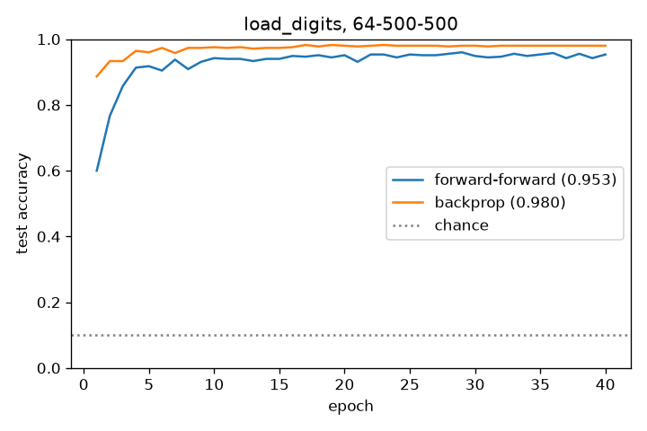

# Forward-Forward on digits

A small PyTorch version of Hinton's Forward-Forward algorithm ([arXiv 2212.13345](https://arxiv.org/abs/2212.13345)), set up as a comparison against a backprop MLP of the same size. Each layer has its own optimizer and learns from a local loss. Gradients never pass from one layer back into the layer before it.

[Method](#method) · [Dataset](#dataset) · [Setup](#setup) · [Run](#run) · [Results](#results) · [Test](#test)

## Method

The supervised variant: the label is written as a one-hot over the first 10 pixels. A positive example gets the correct label and a negative example gets a random wrong one. Each layer wants the goodness (sum of squared ReLU activations) to sit above a threshold for positives and below it for negatives, using a logistic loss. Before an activity vector goes to the next layer it is divided by its length. At test time the network runs once per possible label and picks the label with the highest goodness summed over layers.

## Dataset

MNIST would need a download, so this uses sklearn's bundled `load_digits` (8x8 images, 1797 samples, 25% held out).

## Setup

```bash
pip install -r requirements.txt
```

## Run

```bash
python ff.py            # 64-500-500, 40 epochs, about a minute on CPU
python ff.py --quick    # 64-100-100, 5 epochs
```

Prints train/test accuracy for both models and writes `demo.png`.

## Test

Install pytest separately from the runtime dependencies:

```bash
python -m pip install pytest
```

```bash
python -m pytest -q
```

## Results

With a 64-500-500 net trained for 40 epochs (threshold 2.0, Adam lr 0.003), Forward-Forward reaches 95.3% test accuracy (96.5% train). The backprop MLP with the same hidden layers gets 98.0%. FF also learns more slowly. Backprop is at 93% after two epochs, and FF takes about ten to get there.

### Preview


